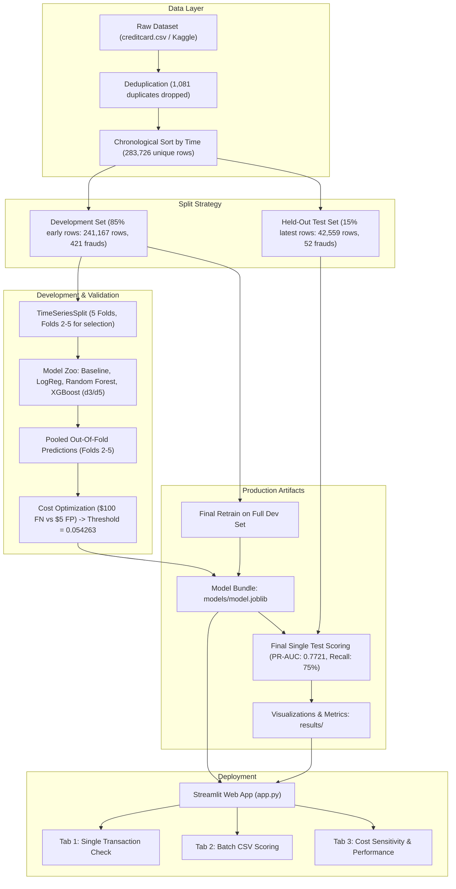

# Credit Card Transaction Fraud Detection

[](https://www.python.org/)
[](#18-license)
[](https://streamlit.io/)
[](https://xgboost.readthedocs.io/)

A production-grade machine learning pipeline and interactive Streamlit application designed to detect fraudulent credit card transactions under extreme class imbalance (~0.172% positive rate). The project demonstrates rigorous, leak-free temporal validation, cost-sensitive threshold tuning, and tree explainability via SHAP.

---

## Table of Contents

- [1. Project Overview](#1-project-overview)
- [2. Key Features](#2-key-features)
- [3. System Architecture](#3-system-architecture)
- [4. Tech Stack](#4-tech-stack)
- [5. Project Structure](#5-project-structure)
- [6. Dataset and Preparation](#6-dataset-and-preparation)
- [7. Methodology and Workflow](#7-methodology-and-workflow)
- [8. Model Selection and Cross-Validation](#8-model-selection-and-cross-validation)
- [9. Cost-Sensitive Threshold Optimization](#9-cost-sensitive-threshold-optimization)
- [10. Verified Test Results](#10-verified-test-results)
- [11. Interactive Streamlit Application](#11-interactive-streamlit-application)
- [12. Installation and Setup](#12-installation-and-setup)
- [13. How to Run](#13-how-to-run)
- [14. Limitations](#14-limitations)
- [15. Future Improvements](#15-future-improvements)
- [16. Reproducibility](#16-reproducibility)
- [17. Contributing](#17-contributing)
- [18. License](#18-license)
- [19. Author](#19-author)
- [20. Acknowledgements and References](#20-acknowledgements-and-references)

---

## 1. Project Overview

Credit card fraud presents unique machine learning challenges:
1. **Extreme Class Imbalance**: Genuine transactions drastically outnumber fraudulent transactions (approximately 1 in 579 transactions is fraudulent). Standard accuracy metrics are useless (a trivial model predicting all genuine achieves 99.83% accuracy while catching zero fraud).
2. **Temporal Order and Data Leakage**: Financial transactions occur chronologically. Standard random K-fold splits leak future patterns into past training windows.
3. **Asymmetric Business Costs**: The cost of missing a fraud (chargeback, merchant fee, customer churn) is significantly higher than the operational friction of an alert investigation. Decision thresholds must reflect real-world economic tradeoffs rather than arbitrary defaults (0.5).

This repository implements an end-to-end fraud detection pipeline that enforces strictly forward-looking temporal cross-validation, compares multiple algorithms against a heuristic baseline, selects decision thresholds using business cost matrices on out-of-fold predictions, and validates final performance on an untouched held-out future test slice.

---

## 2. Key Features

- **Strict Temporal Hygiene**: Sorts chronologically by `Time` and uses `TimeSeriesSplit` across 5 development folds; no future transactions leak into past folds.
- **Leak-Free Preprocessing**: Stateless `FeatureBuilder` extracts `log_amount` and optional temporal/amount indicator flags within `sklearn.pipeline.Pipeline`.
- **Dynamic Positional Weighting**: Dynamically computes `scale_pos_weight = sqrt(neg / pos)` strictly within each fold's training set to counter extreme imbalance.
- **Cost-Sensitive Threshold Tuning**: Optimizes decision cutoffs using asymmetric operational costs ($100 per missed fraud vs. $5 per false alarm investigation; 20:1 ratio) on out-of-fold validation scores.
- **Model Explainability**: Incorporates SHAP (`TreeExplainer`) summary visualizations to identify the primary features driving high-risk scores.
- **Interactive Web Application**: Multi-tab Streamlit interface supporting single-transaction inspection, batch CSV scoring, and dynamic business-cost parameter simulation.
- **Single-Look Held-Out Evaluation**: The final 15% chronological slice is held out and scored only once with zero retroactive parameter tuning.

---

## 3. System Architecture



---

## 4. Tech Stack

| Component | Library / Tool | Role in Project |
| :--- | :--- | :--- |
| **Language** | Python 3.11 / 3.12 | Core programming environment |
| **Data Manipulation** | `pandas` (3.0.1), `numpy` (2.4.2) | Chronological splitting, feature calculations, tabular transformations |
| **Machine Learning** | `scikit-learn` (1.8.0) | Cross-validation (`TimeSeriesSplit`), pipelines, `RobustScaler`, metrics |
| **Gradient Boosting** | `xgboost` (3.2.0) | High-performance tree ensemble classifier (`tree_method='hist'`) |
| **Interpretability** | `shap` (0.51.0) | TreeExplainer SHAP summary plots of feature contributions |
| **Model Persistence** | `joblib` (1.5.3) | Serializing pipelines, decision thresholds, and metadata |
| **User Interface** | `streamlit` (1.56.0) | Real-time interactive scoring and cost-tradeoff exploration UI |
| **Plotting** | `matplotlib` (3.10.8) | Precision-Recall curves and SHAP plots |
| **Dataset Acquisition**| `kagglehub` (1.0.2) | Programmatic dataset download from Kaggle |

---

## 5. Project Structure

```text
CreditCardFraud/
├── .env.example              # Template for optional local environment variables
├── .gitignore                # Comprehensive exclusions (caches, virtualenvs, datasets)
├── app.py                    # Streamlit web application
├── requirements.txt          # Python dependencies
├── data/
│   ├── .gitkeep              # Directory marker
│   └── demo_sample.csv       # 502-row sample from test slice for live demo
├── models/
│   └── model.joblib          # Trained pipeline bundle (model, threshold, column schema)
├── notebooks/
│   └── 01_eda.ipynb          # Exploratory Data Analysis notebook
├── results/
│   ├── baseline_cv.csv       # Per-fold CV metrics for baseline rule
│   ├── cv_results.csv        # Per-fold CV metrics for all tested models
│   ├── pr_curve.png          # Precision-Recall curve on held-out test slice
│   ├── shap_summary.png      # SHAP feature importance summary plot
│   ├── test_metrics.json     # Verified metrics, confusion matrix, and cost savings
│   └── test_scores.csv       # Test set predicted probabilities and ground truth
├── scripts/
│   └── print_versions.py     # Utility script to inspect runtime library versions
└── src/
    ├── __init__.py           # Package marker
    ├── baselines.py          # Phase 1: Data split diagnostics and heuristic baseline
    ├── config.py             # Global constants, paths, and business cost parameters
    ├── cv.py                 # Phase 2: Time-aware 5-fold cross-validation & ablation
    ├── data.py               # Dataset loading, deduplication, and train/test splitting
    ├── evaluate.py           # Shared evaluation logic (PR-AUC, cost calculation)
    ├── features.py           # Stateless FeatureBuilder transformer
    ├── models.py             # Model definitions (Logistic Regression, RF, XGBoost)
    ├── predict.py            # Inference API (scoring and binary threshold decision)
    └── select_and_test.py    # Phase 3: Model selection, threshold tuning, test scoring
```

---

## 6. Dataset and Preparation

### Dataset Information
- **Source**: Machine Learning Group (MLG) at Université Libre de Bruxelles (ULB).
- **Available on Kaggle**: [Credit Card Fraud Detection](https://www.kaggle.com/datasets/mlg-ulb/creditcardfraud).
- **Timeframe & Scope**: Transactions made by European cardholders over a 2-day period in September 2013 (48 hours).
- **Volume**: 284,807 total rows, 492 fraud cases (~0.172% positive class).
- **Feature Set**:
  - `Time`: Seconds elapsed between each transaction and the first transaction in the dataset.
  - `V1` – `V28`: 28 numerical features resulting from Principal Component Analysis (PCA) dimensionality reduction to protect confidentiality.
  - `Amount`: Transaction amount in original currency.
  - `Class`: Response variable (1 for fraud, 0 for genuine).

### Data Preparation Steps
1. **Deduplication**: 1,081 exact duplicate rows are removed, yielding 283,726 unique transactions (473 fraud cases).
2. **Chronological Sorting**: Sorted strictly by `Time` to preserve the time-series integrity (`df["Time"].is_monotonic_increasing`).
3. **Partitioning**:
   - **Development Set (85%)**: First 241,167 transactions (Time: 0.0h – 41.5h, 421 fraud cases). Used exclusively for cross-validation, feature ablation, and threshold tuning.
   - **Held-Out Test Set (15%)**: Final 42,559 transactions (Time: 41.5h – 47.8h, 52 fraud cases). Held completely untouched until final evaluation.

---

## 7. Methodology and Workflow

1. **Feature Engineering**:
   - Raw `Time` and `Amount` are removed from direct tree splitting.
   - `log_amount = log(1 + Amount)` is computed to tame extreme positive skewness.
   - For linear models, `RobustScaler` is fitted on `V1–V28` and `log_amount` to handle outliers without leaking across folds.
2. **Temporal Cross-Validation**:
   - 5-fold `TimeSeriesSplit` on the development set.
   - Fold 1 serves as an initial anchor/warmup; selection decisions are evaluated on folds 2–5.
3. **Imbalance Handling**:
   - XGBoost utilizes dynamic class weighting: `scale_pos_weight = sqrt(neg / pos)` computed strictly on each fold's training slice.
4. **Out-of-Fold Threshold Selection**:
   - Validation probabilities from folds 2–5 are pooled.
   - The decision threshold is selected by minimizing the operational cost curve:
     $$\text{Cost} = C_{\text{FN}} \cdot \text{FN} + C_{\text{FP}} \cdot \text{FP}$$
     with $C_{\text{FN}} = 100.0$ and $C_{\text{FP}} = 5.0$ (20:1 penalty ratio).
5. **Final Evaluation**:
   - Model is trained on the full development set and evaluated exactly once on the held-out test set.

---

## 8. Model Selection and Cross-Validation

Cross-validation performance averaged across selection folds (Folds 2 to 5):

| Model | Mean PR-AUC | Std PR-AUC | Mean Recall @ Precision $\ge$ 50% |
| :--- | :---: | :---: | :---: |
| **XGBoost (depth 5)** (`xgb_d5`) | **0.7807** | 0.0711 | **82.59%** |
| **XGBoost (depth 3)** (`xgb_d3`) | **0.7807** | **0.0640** | 82.11% |
| **Random Forest** (`rf`) | 0.7687 | 0.0830 | 82.11% |
| **Logistic Regression** (`logreg`) | 0.7202 | 0.1182 | 79.76% |
| **Baseline Rule** (`Amount <= 1`) | 0.0021 | 0.0013 | 0.00% |

`xgb_d5` was selected as the champion model due to top-tier PR-AUC and highest average recall at operational precision ($\ge 50\%$).

---

## 9. Cost-Sensitive Threshold Optimization

Rather than using an arbitrary 0.5 classification threshold, the cutoff was optimized against empirical out-of-fold validation predictions using varying business loss functions:

| Cost Scenario ($C_{\text{FN}} : C_{\text{FP}}$) | Chosen Threshold | OOF Recall | OOF Precision | Alerts per 1,000 Tx | Cost Reduction |
| :---: | :---: | :---: | :---: | :---: | :---: |
| **Conservative (5:1)** | `0.1559` | 81.78% | 72.73% | 1.57 / 1,000 | 75.64% |
| **Balanced / Production (20:1)** | **`0.0543`** | **84.00%** | **58.51%** | **2.01 / 1,000** | **81.02%** |
| **Aggressive Recall (100:1)** | `0.0101` | 86.22% | 30.46% | 3.96 / 1,000 | 84.25% |

The selected operational threshold is **`0.054263`**.

---

## 10. Verified Test Results

Scored **once** on the untouched 15% held-out test slice (42,559 transactions; 52 true fraud cases):

### Key Metrics Summary

| Metric | Champion Model (`xgb_d5` @ $t = 0.0543$) | Heuristic Baseline (`Amount <= 1`) |
| :--- | :---: | :---: |
| **PR-AUC (Average Precision)** | **0.7721** | 0.0023 |
| **Recall** | **75.00%** (39 / 52 caught) | 38.46% (20 / 52 caught) |
| **Precision** | **54.17%** (39 / 72 flagged) | 0.40% (20 / 5,012 flagged) |
| **F1-Score** | **0.6290** | 0.0079 |
| **False Alarms (FP)** | **33** | 4,992 |
| **Alert Rate** | **1.69 per 1,000 transactions** | 117.77 per 1,000 transactions |
| **Total Cost ($100 FN + $5 FP)** | **\$1,465.00** | \$28,160.00 |
| **Cost Savings vs. Flagging Nothing** | **+71.83%** | -441.54% |

### Confusion Matrix on Test Set

| | Predicted Genuine | Predicted Fraud |
| :--- | :---: | :---: |
| **Actual Genuine** | 42,474 (TN) | 33 (FP) |
| **Actual Fraud** | 13 (FN) | 39 (TP) |

### Visual Artifacts

The test run generated the following evaluation plots located in [`results/`](results/):

- **Precision-Recall Curve** ([`results/pr_curve.png`](results/pr_curve.png)): Demonstrates high precision across operating recall thresholds up to 75%.
- **SHAP Summary Plot** ([`results/shap_summary.png`](results/shap_summary.png)): Highlights that features $V14$, $V10$, $V12$, $V4$, and $V17$ provide the strongest predictive signals for fraud.

---

## 11. Interactive Streamlit Application

The interactive web demo provides intuitive tools for real-world testing:

1. **Tab 1: Check a Transaction**:
   - Inspect individual transactions from the held-out sample (`data/demo_sample.csv`).
   - Dynamically slide the decision threshold to observe real-time classification changes ("Approve" vs. "FLAG / review").
   - View ground truth labels and underlying raw PCA components.
2. **Tab 2: Batch Scoring**:
   - Upload any CSV containing `Time`, `V1`–`V28`, and `Amount`.
   - Score transactions in batch, filter flagged high-risk records, and download the resulting scored CSV.
3. **Tab 3: Model Performance & Cost Simulator**:
   - Adjust hypothetical business loss costs ($C_{\text{FN}}$ and $C_{\text{FP}}$) in real time to see how the optimal threshold and net cost savings adapt.
   - Inspect the held-out test confusion matrix, PR curve, and SHAP summary plots.

---

## 12. Installation and Setup

### Prerequisites
- Python 3.11 or 3.12
- Git

### 1. Clone the Repository
```bash
git clone https://github.com/Dhruv6305/CreditCardFraudDetection.git
cd CreditCardFraudDetection
```

### 2. Set Up a Virtual Environment
```bash
# Windows
python -m venv .venv
.venv\Scripts\activate

# macOS / Linux
python3 -m venv .venv
source .venv/bin/activate
```

### 3. Install Dependencies
```bash
pip install --upgrade pip
pip install -r requirements.txt
```

### 4. Optional: Configure Environment Variables
If you already have `creditcard.csv` locally:
```bash
# Windows (cmd / powershell)
copy .env.example .env
# Set FRAUD_CSV="path/to/creditcard.csv" inside .env
```

---

## 13. How to Run

### Run the Interactive Streamlit App
```bash
streamlit run app.py
```
Open [http://localhost:8501](http://localhost:8501) in your browser.

### Run Inference via Python API
```python
import pandas as pd
from src.predict import load_bundle, score, decide

# Load saved pipeline and threshold
bundle = load_bundle()

# Load sample data
sample_df = pd.read_csv("data/demo_sample.csv")

# Generate fraud scores and binary decisions
scores = score(bundle, sample_df)
flags = decide(scores, bundle["threshold"])

print(f"Scored {len(scores)} transactions; flagged {flags.sum()} as potential fraud.")
```

### Re-run the Pipeline from Scratch (Optional)

> **Note**: Running full cross-validation and training requires downloading the full ~144 MB dataset. If `FRAUD_CSV` is not set, `kagglehub` will automatically download it.

1. **Verify Splits and Heuristic Baseline**:
   ```bash
   python -m src.baselines
   ```
2. **Execute Full 5-Fold Time-Series Cross-Validation**:
   ```bash
   python -m src.cv
   ```
3. **Select Model, Tune Cost Threshold, and Score Test Slice**:
   ```bash
   python -m src.select_and_test --force
   ```

---

## 14. Limitations

1. **Limited Temporal Window**: The dataset spans only 48 consecutive hours (September 2013). Seasonal patterns, day-of-week trends, and long-term fraud evolution cannot be captured.
2. **Small Test Fraud Sample**: The held-out test split contains 52 fraud cases. A difference of 1 or 2 caught frauds causes ~2–4% swings in reported recall.
3. **Anonymized Features**: Because `V1`–`V28` are anonymized PCA components, domain-specific feature engineering (e.g., velocity rules, merchant categories, billing vs. shipping matches) cannot be constructed.
4. **Arbitrary Cost Ratios**: The $100 FN / $5 FP ratio is a reasonable banking benchmark, but actual costs depend on transaction value, chargeback fees, and operational tiering.
5. **Ranking Score vs. Calibrated Probability**: Due to class re-weighting (`scale_pos_weight`), output probabilities are monotonic ranking scores rather than calibrated posterior probabilities.

---

## 15. Future Improvements

- [ ] **Cost Matrix Calibration by Transaction Amount**: Integrate variable transaction amounts directly into the cost function rather than assuming a fixed $100 loss per missed fraud.
- [ ] **Concept Drift & Recalibration**: Implement rolling-window evaluation or adaptive thresholding to detect drift across time.
- [ ] **Alternative Architectures**: Evaluate LightGBM and CatBoost under the same temporal CV harness.
- [ ] **Dockerization**: Provide a Dockerfile and docker-compose configuration for one-command containerized deployment.
- [ ] **REST API Endpoint**: Expose a FastAPI microservice alongside Streamlit for low-latency scoring requests.

---

## 16. Reproducibility

- Random seeds are fixed project-wide (`RANDOM_STATE = 42` in [`src/config.py`](src/config.py)).
- XGBoost uses deterministic histogram tree construction (`tree_method='hist'`).
- The test set was locked with a guard check in [`src/select_and_test.py`](src/select_and_test.py) to prevent unintentional data leakage or iterative overfitting.

---

## 17. Contributing

Contributions, feedback, and pull requests are welcome:
1. Fork the repository.
2. Create a feature branch (`git checkout -b feature/improvement`).
3. Commit your changes (`git commit -m "Add feature/improvement"`).
4. Push to your branch (`git push origin feature/improvement`).
5. Open a Pull Request.

---

## 18. License

This repository currently has no explicit open-source license. All rights are reserved by the author.

---

## 19. Author

- **Author**: Dhruv
- **GitHub**: [@Dhruv6305](https://github.com/Dhruv6305)
- **Email**: [dhruvchudasama118@gmail.com](mailto:dhruvchudasama118@gmail.com)

---

## 20. Acknowledgements and References

- **Dataset Creators**: Andrea Dal Pozzolo, Olivier Caelen, Reid A. Johnson, and Gianluca Bontempi. *Calibrating Probability with Undersampling for Unbalanced Classification*. IEEE SSCI 2015.
- **ULB Machine Learning Group**: [ULB MLG](https://mlg.ulb.ac.be).
- **Libraries**: Scikit-Learn, XGBoost, SHAP, Streamlit, and KaggleHub.
